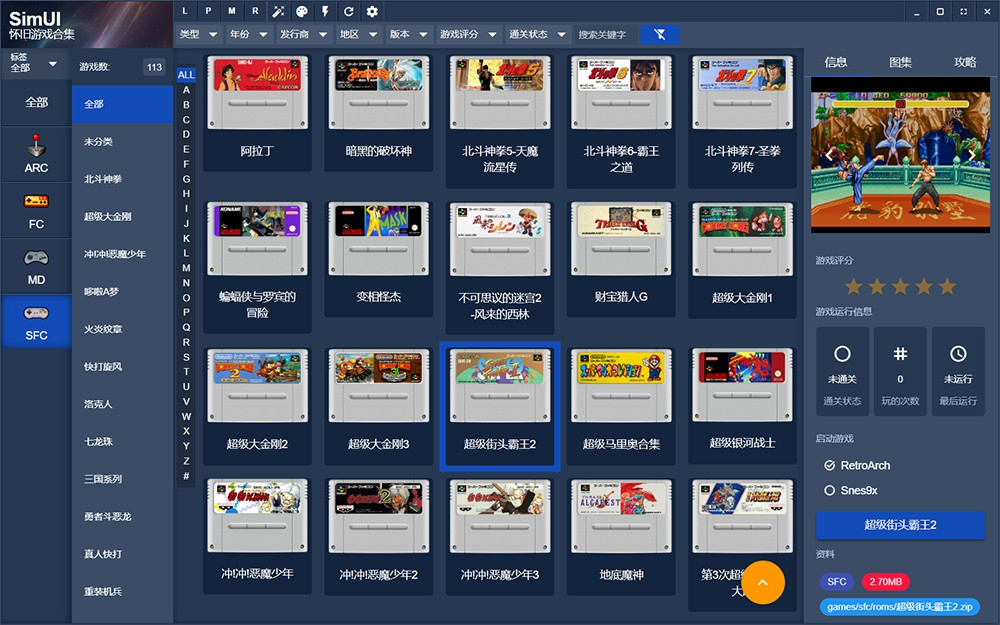
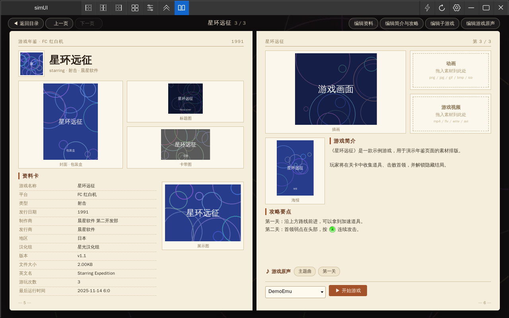
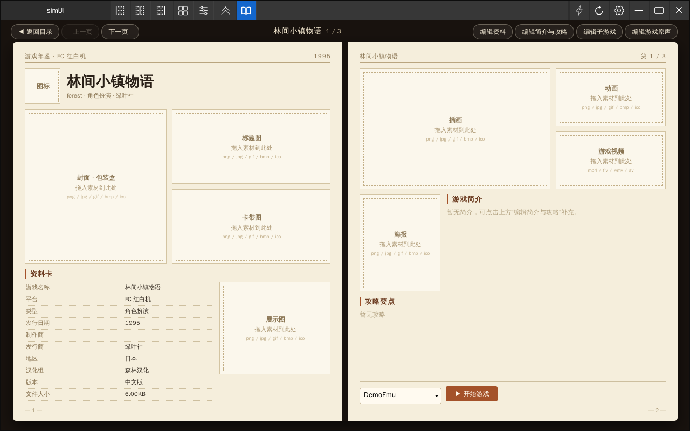

**SimUI是一款绿色、轻量级、配置自由的模拟游戏ROM管理软件。**

软件支持自由添加游戏平台、支持多游戏模拟器、多游戏目录； 

支持ROM别名，ROM子游戏； 

支持多种展示图、场景展示视频、支持gif动画；  

支持游戏简介、游戏攻略，支持富文本显示，支持txt、markdown、html三种语法，并可以混合运用；  

支持自定义皮肤、支持多语言；

还支持懒加载、软件改名、一键下载缩略图、快捷工具等诸多功能。




&nbsp;
## 游戏年鉴（单游戏页面）

软件启动后直接打开“游戏年鉴”：每个游戏占一个跨页，像翻开一本年鉴图书。



素材的摆放位置如下。没有素材的位置会显示虚线占位框，把图片或视频拖进去，就会保存为该游戏对应的素材：

| 位置 | 素材类型（平台目录） |
| --- | --- |
| 左页 · 标题旁 | 图标 `icon` |
| 左页 · 大图 | 封面 / 包装盒 `packing` |
| 左页 · 右上 | 标题画面 `title` |
| 左页 · 右下 | 卡带 `cassette` |
| 左页 · 资料卡 | 类型、发行日期、制作商、发行商、地区、汉化组、版本、文件大小、英文名/日文名、其他信息、游玩次数 + 展示图 `thumb` |
| 右页 · 大图 | 游戏画面 / 插画 `snap` |
| 右页 · 右侧 | 动态画面 `gif`、游戏视频 `video`（静音循环） |
| 右页 · 中部 | 海报 `poster` + 游戏简介 `docs` |
| 右页 · 下部 | 攻略要点 `strategies` + 图文杂志 `files`、游戏原声 `audio`、模拟器选择、开始游戏 |
| 页面背景 | 背景图 `background`，没有则使用壁纸 `wallpaper` |



操作方式：

- 翻页：工具栏“上一页 / 下一页”、键盘方向键或 PageUp / PageDown、手柄方向键、在工具栏上滚动鼠标滚轮
- 开始游戏：Enter 键，或点击“开始游戏”
- 返回游戏目录：Esc 键，或点击“返回目录”
- 从目录打开：点击标题栏的年鉴按钮，或在游戏上点右键选择“打开年鉴页”
- 工具栏可编辑资料、简介与攻略、子游戏、游戏原声，编辑后当前页自动刷新
- 还没有任何游戏时（首次使用）停留在目录界面，先完成平台设置

> 本仓库已合并上游 `dev` 分支（2.8 开发版：新资料字段、游戏原声、子游戏编辑、视频背景、玩的最多等）。游戏原声通过 `tools/CHKenPlayer/CHKenPlayer.exe` 播放，该播放器不在仓库中，需要自行放入软件目录。

相关代码：`code/view/tis/book.tis`，样式和结构在 `code/view/main.html`。

## GitHub 自动编译

`.github/workflows/build-windows.yml` 在每次 push 时，用 Ubuntu 和 MinGW-w64 交叉编译 Windows 64 位版本：

1. 用 `build/linux/packfolder` 重新打包 `code/view`，生成 `code/res.go`
2. 用 `x86_64-w64-mingw32-windres` 生成 `code/res.syso`（图标和 manifest）
3. `go build` 生成 `simUI-64.exe`
4. 下载 Sciter 4.4.8.23 运行库 `sciter-64.dll`（固定提交并校验 SHA256）
5. 加入 `lang`、`theme`、`icons` 和清空过的 `data.dll`（已预先执行 `_upgrade_2.7-2.8.sql`），打包为 `SimUI-win64`

编译结果在 Actions 页面对应运行的 Artifacts 中下载。推送 `v*` 标签时，会自动发布到 Releases。

&nbsp;
## 软件地址

[www.simui.net/](http://www.simui.net/)


## 编译工具

静态资源编译工具：

`packfolder.bat`

编译测试包：

`build/build_dev.bat`

编译64位系统正式包：

`build/build_product_64.bat`

编译32位系统正式包（需在32位系统下执行）：

`build/build_product_32.bat`


## 部署方法

1. clone本项目
2. 将simUI完整二进制项目放进项目app目录
3. 根据环境情况配置 main.go文件中的`isDebug`变量，是否开启调试模式
4. 执行`build/build_dev.bat`编译项目
5. 生成app/sciter-64.exe文件完成，启动项目


## 代码结构

```
.
├── config                      # 配置
│   └── config.go               # 项目配置包
├── controller                  # 控制器（业务入口）
│   ├── Cache.go                # 缓存
│   ├── Config.go               # 配置
│   ├── Menu.go                 # 菜单
│   ├── Platform.go             # 平台
│   ├── Public.go               # 公共函数
│   ├── Rom.go                  # 游戏rom
│   ├── RomCmd.go               # 游戏单一模拟器参数
│   ├── Shortcut.go             # 快捷工具
│   └── Simulator.go            # 模拟器
├── db                          # 数据库module
│   ├── config.go               # 配置表
│   ├── db.go                   # 初始化方法
│   ├── menu.go                 # 菜单表
│   ├── platform.go             # 平台表
│   ├── rom.go                  # rom表
│   ├── shortcut.go             # 快捷工具表
│   ├── simconf.go              # rom表（rom表的模拟器配置）
│   └── simulator.go            # 模拟器表
├── go.mod
├── go.sum
├── main.go                      # 入口函数
├── modules                      # 功能模块
│   ├── Backup.go                # 备份恢复相关方法
│   ├── Rom.go                   # rom相关方法
│   ├── RomCache.go              # rom缓存相关方法
│   ├── RomRename.go             # rom重命名相关方法
│   ├── menu.go                  # 菜单相关方法
│   ├── simulator.go             # 模拟器相关方法
│   ├── thumb.go                 # 缩略图相关方法
│   ├── upgrade.go               # 软件更新相关方法
│   └── zip.go                   # 压缩相关方法
├── res.go                       # 静态资源打包文件
├── res.syso                     # 静态资源syso
├── utils                        # 公共方法
│   ├── conv.go                  # 数据转换方法
│   ├── encode.go                # 编码方法
│   ├── file.go                  # 文件方法
│   ├── filepath.go              # 路径方法
│   ├── http.go                  # http方法
│   ├── rom.go                   # 游戏相关方法
│   ├── slice.go                 # 切片方法
│   └── string.go                # 字符串方法
│   ├── pinyin                   # 拼音转换库
│   │   ├── ...
│   ├── sciter                   # go-sciter库
│   │   ├── ...
└── view                         # 视图
│    ├── about.html              # 关于页面
│    ├── add_platform.html       # 添加平台页面
│    ├── config.html             # 配置页面
│    ├── desc.html               # 攻略页面
│    ├── down_thumbs.html        # 下载缩略图页面 
│    ├── edit_rom_cmd.html       # 编辑模拟器参数页面
│    ├── edit_sim.html           # 编辑模拟器页面
│    ├── edit_thumbs.html        # 编辑缩略图页面
│    ├── main.html               # 首页
│    ├── rom_rename.html         # 重命名页面
│    └── tis                     # 脚本
│    │   ├── event.tis           # 公共事件
│    │   ├── keycode.tis         # 键盘快捷键
│    │   ├── menu.tis            # 菜单
│    │   ├── platform.tis        # 平台
│    │   ├── rom.tis             # rom
│    │   ├── sidebar.tis         # 侧边栏
│    │   ├── statebar.tis        # 状态栏
│    │   ├── thumb.tis           # 缩略图
│    │   ├── utils.tis           # 公共方法
│    │   └── window.tis          # 窗体相关
│    │   ├── context.tis         # 右键菜单
│    │   ├── dialog              # 子页面脚本
│    │   │   ├── config.tis      # 配置
│    │   │   ├── desc.tis        # 攻略
│    │   │   ├── down_thumbs.tis # 下载缩略图
│    │   │   ├── edit_sim.tis    # 编辑模拟器
│    │   │   ├── edit_thumbs.tis # 编辑rom模拟器参数
│    │   │   └── rom_rename.tis  # 重命名
│    │   ├── plugins             # sciter插件
│    │   │   ├── decorators.tis  # 快捷键支持
│    │   │   ├── dragdrop.tis    # 拖拽换图
│    │   │   ├── markdown.tis    # markdown
│    │   │   ├── rotator.tis     # 滑动焦点图
│    │   │   ├── tabs.tis        # tab
│    │   │   └── vlist.tis       # 列表
│    ├── images                  # 图片资源
│    │   ├── *.jpg/png           # 图片资源
│    │   ├── iconfont.ttf        # 字体图标
│    │   ├── public.css          #  样式文件
```


simUI二进制包目录结构

```
── app
│   ├── data.dll        # sqlite数据库文件
│   ├── sciter-32.dll   # sciter32位引擎
│   ├── sciter-64.dll   # sciter64位引擎
│   ├── sciter-32.exe   # simUI32位执行文件
│   ├── sciter-64.exe   # simUI64位执行文件
│   ├── theme           # 主题目录
│   │   ├── *.css       # 主题css文件
│   │   ├── *.png/jpg   # 主题相关图片文件
│   ├── icons           # 平台图标目录
│   │   ├── *.ico
│   ├── lang            # 语言
│   │   ├── 简体中文.ini  # 简体中文语言文件
│   │   └── 繁体中文.ini  # 繁体中文语言文件
```

