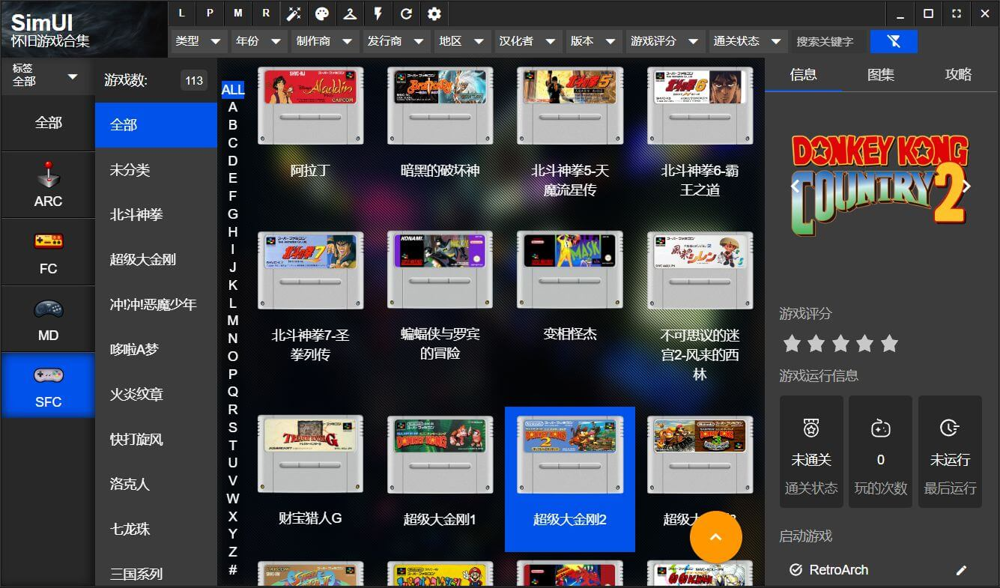
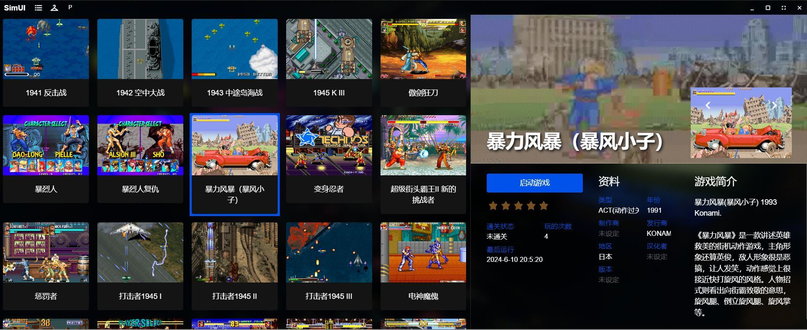
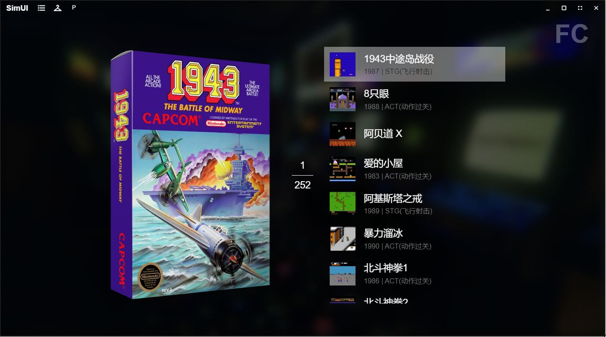
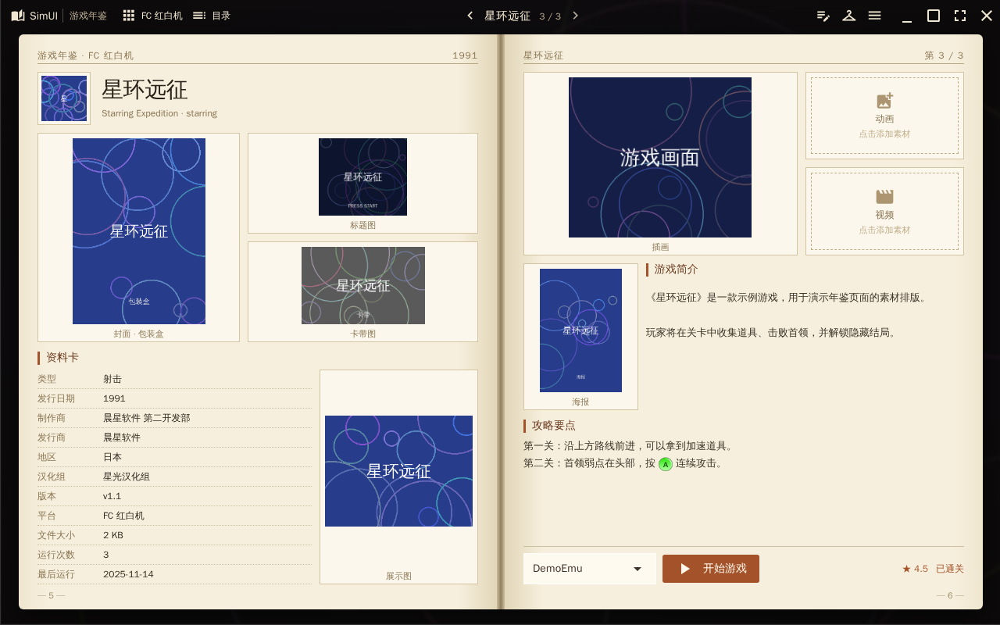
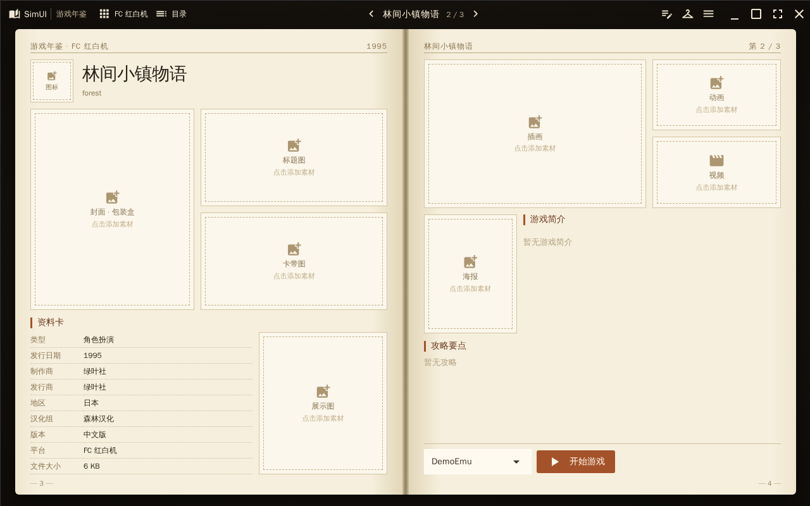
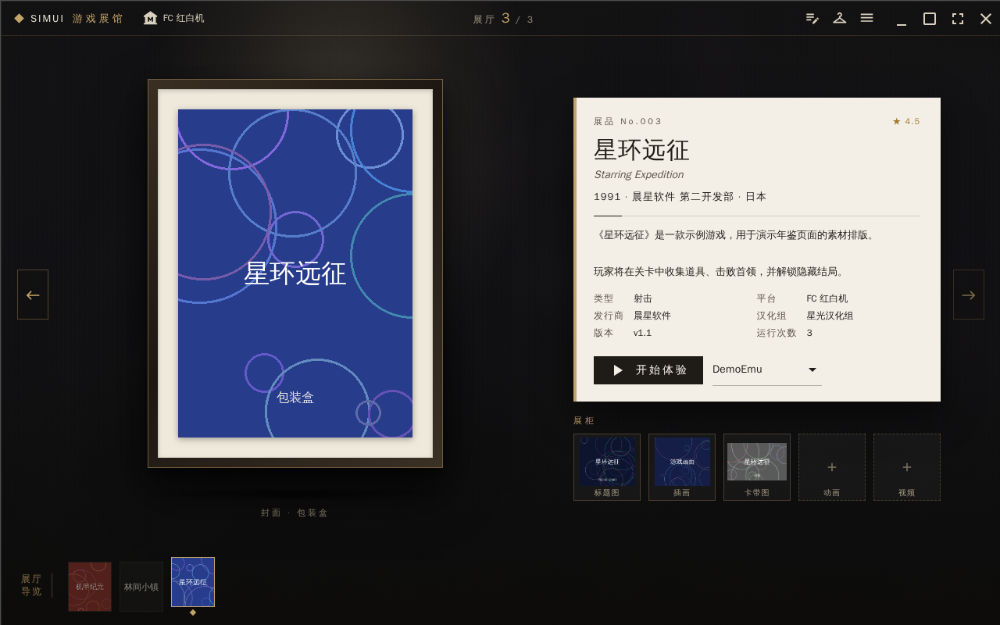

[[EN]](README_EN.md)

**SimUI Pulsar 是由热爱街机文化的玩家开发的免费专业游戏ROM管理软件。是SimUI的重构版本。**


## 软件介绍

我们希望打造极致的产品，融入工匠精神，不断探索每一种更好的可能。SIMUI以资料收集和分享为圆心，为玩家打造更具品质的模拟游戏图书馆软件。

软件支持自由添加游戏平台、支持多游戏模拟器、多游戏目录；

支持ROM别名，ROM子游戏、支持游戏资料定义；

支持多种展示图显示、支持gif动画、支持游戏音乐、支持视频；

支持游戏简介、游戏攻略，支持富文本显示；

支持自定义皮肤、支持多语言；

支持手柄、支持摇杆；

软件懒加载机制、软件改

名、下载缩略图、自定义实用工具等诸多功能。







&nbsp;
## 游戏年鉴主题（Book）

本仓库新增了 **Book · 年鉴** 主题，安装包默认使用。打开软件后直接显示单个游戏的跨页，像翻开一本游戏年鉴：



| 位置 | 内容 |
| --- | --- |
| 左页 · 标题旁 | 图标 `icon` |
| 左页 · 大图 | 封面 / 包装盒 `packing` |
| 左页 · 右上、右下 | 标题图 `title`、卡带图 `cassette` |
| 左页 · 资料卡 | 类型、发行日期、制作商、发行商、地区、汉化组、版本、平台、文件大小、其他信息、运行记录 + 展示图 `thumb` |
| 右页 · 大图 | 插画 `snap` |
| 右页 · 右侧 | 动画 `gif`、视频 `video`（静音循环，点击暂停） |
| 右页 · 中部 | 海报 `poster` + 游戏简介 `docs` |
| 右页 · 下部 | 攻略要点 `strategies` + 图文杂志 `files`、模拟器选择、开始游戏、子游戏、评分与通关状态 |
| 桌面背景 | 背景图 `background`，没有则使用平台界面背景 |

缺少素材的位置显示占位框，点击即可从本地选择图片或视频添加：



操作方式：

- **翻页**：标题栏 ‹ ›、方向键、PageUp / PageDown、鼠标滚轮、手柄方向键；Home 回到第一页
- **开始游戏**：Enter、手柄确认键，或点击“开始游戏”
- **目录**：点击“目录”或按 T，可搜索并跳转到任意游戏
- **切换平台 / 分类**：点击标题栏的平台名，或按手柄的平台键
- **编辑**：在页面上点右键或点“编辑本页”，使用与经典主题相同的菜单（编辑资料、编辑图集、子游戏、文件操作等）
- **切换主题**：衣架图标，可在 Book / Gallery / Classic / Playnite / Tiny / OICQ 之间切换

相关代码：`frontend/src/pages/book/`、`frontend/src/css/book/book.css`。

## 游戏展馆主题（Gallery）

**Gallery · 展馆** 把每个游戏当作展馆里的一件展品：



- **主展品**：封面装在带衬纸的画框里，顶灯照明。按包装盒 → 海报 → 展示图 → 插画 → 标题图的顺序取第一张；没有封面时点击画框添加
- **说明牌**：展品编号、名称、英文/日文名、年代 · 出品方 · 地区、简介、类型/平台/发行商/汉化组/版本、评分、开始体验与模拟器选择、子游戏
- **展柜**：标题图、插画、卡带图、动画、视频（视频静音循环）；空位点击即可添加
- **展厅导览**：底部缩略图带，点击走到对应展品，当前展品自动居中
- **墙面**：游戏背景图模糊压暗作为墙面
- 操作与年鉴主题相同：方向键/滚轮/手柄翻页，Enter 开始，右键编辑，衣架图标切换主题

两个单游戏主题共用 `frontend/src/composables/useGameBrowser.ts`（列表、翻页、详情、运行、素材、编辑、键盘手柄、窗口控制）。

## 语言文件与运行资源

上游仓库没有包含运行所需的 `language/` 和 `resources/`，本仓库补齐了：

- `language/简体中文.ini`、`language/English.ini`：覆盖前端与后端用到的全部词条（400 个）
- `resources/background.png`、`resources/logo.png`：默认背景与默认平台图
- `tools/dbschema`：把仓库自带的早期数据库 `data.dll` 补齐到当前代码使用的表结构，并清空开发数据，生成可直接发布的 `data.db`

```
go run ./tools/dbschema -db data.db -clean -theme Book -lang zh-CN
```

## GitHub 自动编译

`.github/workflows/build-pulsar.yml` 在 `pulsar/` 有改动时，于 Windows 环境中执行：

1. 安装 Go、Node.js、Wails CLI v2.12.0
2. 用 `tools/dbschema` 生成发布用数据库（默认主题 Book、默认语言简体中文）
3. `wails build` 编译前端与 `simui-pulsar.exe`
4. 打包 `simui-pulsar.exe`、`data.db`、`language/`、`resources/` 为 `SimUI-Pulsar-win64`

编译结果在 Actions 页面对应运行的 Artifacts 中下载；推送 `pulsar-v*` 标签时自动发布到 Releases。运行需要系统已安装 WebView2（Windows 10/11 自带）。

&nbsp;
## 软件地址

[www.simui.net/](http://www.simui.net/)


## 技术栈

GOLANG + wails + vue3 + quasar

## 目录说明

```
build 编译目录
components 业务组件
config 配置相关
constant 常量定义
controller （前端调用入口）
db 数据库dao
frontend 前端代码
modules 业务模块
request 结构体定义
utils  公共库
```


## 相关技术文档

wails:https://wails.io/docs/introduction/

vue3:https://vuejs.org/guide/introduction.html

quasar:https://quasar.dev/docs
